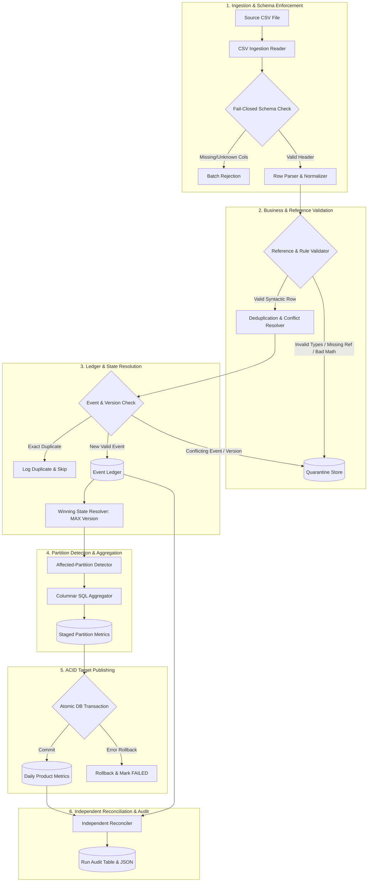

# Daily Metrics Data Pipeline: Incremental State Resolution & Independent Reconciliation

[](https://www.python.org/downloads/)
[](https://duckdb.org/)
[](https://docs.pytest.org/)
[](LICENSE)

An enterprise-grade, deterministic, incremental data processing pipeline built for the **YottaFlex.ai** Technical Assignment for the role of **AI Data Forward Deployed Engineer (Intern + Full Time)**.

---

## Table of Contents

1. [Executive Summary](#1-executive-summary)
2. [Business Problem and Scope](#2-business-problem-and-scope)
3. [Key Capabilities](#3-key-capabilities)
4. [Technology Stack & Justification](#4-technology-stack--justification)
5. [Architecture and Processing Flow](#5-architecture-and-processing-flow)
6. [Business Rules and Event Semantics](#6-business-rules-and-event-semantics)
7. [Source and Target Schemas](#7-source-and-target-schemas)
8. [Idempotency, Recovery, and Transaction Strategy](#8-idempotency-recovery-and-transaction-strategy)
9. [Directory Structure](#9-directory-structure)
10. [Quickstart & Installation](#10-quickstart--installation)
11. [Pipeline Execution Guide](#11-pipeline-execution-guide)
12. [Automated Testing & Coverage](#12-automated-testing--coverage)
13. [Reconciliation Results](#13-reconciliation-results)
14. [Performance Benchmark (100,000 Records)](#14-performance-benchmark-100000-records)
15. [Operations & Runbook Reference](#15-operations--runbook-reference)
16. [Known Limitations & Production Evolution](#16-known-limitations--production-evolution)
17. [Submission Contents](#17-submission-contents)

---

## 1. Executive Summary

In high-throughput transactional environments (e-commerce, fintech, IoT), event data arrives continuously from upstream systems, often out of order, duplicated across network retries, or corrected post-hoc via updates and cancellations. Naive batch pipelines that overwrite tables or blindly sum incoming records produce corrupted analytical KPIs, double-counted revenues, and unrecoverable data drift.

This project delivers a **production-ready incremental data pipeline** that ingests transaction events, enforces strict fail-closed schema integrity, resolves current transaction state using deterministic version precedence, isolates invalid data in quarantine stores, recomputes affected daily product metrics with atomic ACID transactions, and validates all results using an **independent declarative reconciler**.

---

## 2. Business Problem and Scope

### The Problem
Maintain authoritative daily product-level metrics from transaction events:
* **Units Sold**: Total quantity transacted.
* **Transaction Count**: Total distinct active transactions.
* **Gross Revenue**: Decimal-safe sum of monetary transactions.

### Real-World Complexities Handled
* **New Transactions**: Ingestion and aggregation.
* **Updates to Existing Transactions**: Price, quantity, product, or date adjustments.
* **Transaction Reversals / Cancellations**: Clean removal from active reporting metrics.
* **Transaction Reinstatements**: Higher-version upsert after a cancellation.
* **Duplicate Event Delivery**: Exact duplicate events idempotently handled without inflating counts.
* **Conflicting Duplicate Event IDs**: Same event ID with different payloads detected and quarantined.
* **Conflicting Versions**: Two distinct records claiming the same transaction version quarantined.
* **Late-Arriving & Out-of-Order Events**: State resolution dictated strictly by source event version, not arrival time.
* **Malformed Records & Missing Fields**: Fail-closed schema enforcement and row-level quarantine.
* **Invalid Reference Keys**: Referential integrity checked against active product and customer catalogs.
* **Empty Input Batches**: Graceful zero-record handling.
* **Partial Failures & Safe Retries**: ACID transaction boundaries with automatic rollback on error.
* **Historical Backfills**: Seamless recalculation of historical reporting partitions.

### Non-Goals
* Cloud infrastructure provisioning (AWS, GCP, Kubernetes) is intentionally excluded to guarantee 100% reproducible zero-credential local execution.
* Streaming ingestion (Kafka/Flink) is omitted in favor of reliable, auditable micro-batch processing.

---

## 3. Key Capabilities

* **Deterministic State Resolution**: Winning state is evaluated via windowed version ranking:
  `ROW_NUMBER() OVER (PARTITION BY transaction_id ORDER BY event_version DESC, event_ts DESC) == 1`.
* **Affected-Partition Recomputation**: Scales at $O(K)$ over modified reporting periods rather than expensive $O(N)$ full-ledger scans.
* **Empty-Partition Cleanup**: Deletes target partition records when all constituent transactions are reversed or moved to another date.
* **Zero Silent Data Loss**: Every invalid row is preserved in `quarantine_records` with raw JSON and machine-readable error reasons.
* **Independent Reconciliation Engine**: Computes ground truth directly from raw event ledger and asserts zero variance across revenue, units, and transaction counts.
* **ACID Transaction Guarantees**: Target updates, ledger inserts, and quarantine logs commit atomically or roll back completely on failure.

---

## 4. Technology Stack & Justification

| Technology | Purpose in System | Justification & Requirement Satisfied | Alternatives Considered & Rejected |
|---|---|---|---|
| **Python 3.11+** | Pipeline Orchestration, Ingestion & Validation | Standard language for data engineering, robust typing, cross-platform portability. | Go, Rust (slower velocity, separate toolchains). |
| **DuckDB 2.0+** | Analytical OLAP Engine, ACID Transactions | Vectorized columnar execution, zero-credential local execution, native `DECIMAL(18,2)` precision. Satisfies REQ-01, REQ-09, REQ-13. | SQLite (no native decimal, slow OLAP), Postgres (requires daemon/credentials). |
| **Pandas 3.1+** | Tabular Data Ingestion & Export | High-performance CSV parsing and data frame export to reporting formats. | Python standard CSV alone (less performant on exports). |
| **pytest 9.2+** | Automated Testing Framework | Isolated fixtures, parametrization, and rigorous regression validation. Satisfies REQ-20. | unittest (less expressive fixtures). |
| **PyTZ / ZoneInfo**| Timestamp Normalization | Guarantees timezone-aware UTC alignment for daily partitioning. | Local naive timestamps (causes timezone drift). |

---

## 5. Architecture and Processing Flow



---

## 6. Business Rules and Event Semantics

### 6.1 Event Model & Version Precedence
* **Event Types**:
  * `UPSERT`: Complete snapshot of current transaction state.
  * `REVERSAL`: Cancels the transaction; removes it from active analytical metrics.
* **Precedence Rule**:
  * The highest valid `event_version` determines transaction state.
  * Arrival time (`ingested_at`) NEVER dictates state precedence.
  * If a late-arriving event with an older version arrives, it is appended to the ledger for auditability, but the active winning state remains the newer version.

### 6.2 Duplicate & Conflict Resolution Matrix

| Event Condition | Resolution Action | Ledger Impact | Metrics Impact |
|---|---|---|---|
| Same `event_id` + identical `payload_hash` | Exact Duplicate Delivery | Skipped | Zero (Idempotent) |
| Same `event_id` + differing `payload_hash` | Conflicting Duplicate Event | Quarantined (`CONFLICTING_EVENT_PAYLOAD`) | Zero |
| Same `(transaction_id, version)` + differing payload | Conflicting Version | Quarantined (`CONFLICTING_TRANSACTION_VERSION`) | Zero |
| Higher `event_version` UPSERT | Transaction Update | Appended to Ledger | Partition Recomputed |
| Higher `event_version` REVERSAL | Transaction Cancellation | Appended to Ledger | Partition Reduced |
| Lower `event_version` (Late arrival) | Late-arriving historical event | Appended to Ledger | Stays with higher version |

---

## 7. Source and Target Schemas

### 7.1 Source Schema (`source_csv`)

| Column | Physical Type | Mandatory | Business Rule |
|---|---|---|---|
| `event_id` | VARCHAR | YES | Unique idempotency key. |
| `transaction_id` | VARCHAR | YES | Business transaction identifier. |
| `event_version` | BIGINT | YES | Strictly positive integer (`> 0`). |
| `event_type` | VARCHAR | YES | `'UPSERT'` or `'REVERSAL'`. |
| `product_id` | VARCHAR | Conditional | Required for UPSERT; foreign key to `reference_products`. |
| `customer_id` | VARCHAR | Conditional | Required for UPSERT; foreign key to `reference_customers`. |
| `event_ts` | VARCHAR | YES | ISO-8601 UTC timestamp string. |
| `quantity` | BIGINT | Conditional | Required and `> 0` for UPSERT. |
| `unit_price` | DECIMAL(18,2) | Conditional | Required and `>= 0.00` for UPSERT. |
| `ingested_at` | VARCHAR | NO | Ingestion lineage timestamp. |
| `source_file` | VARCHAR | NO | Source lineage filename. |

### 7.2 Target Analytical Table (`daily_product_metrics`)

| Column Name | Physical Type | Constraint | Business Metric Definition |
|---|---|---|---|
| `metric_date` | DATE | Composite PK (1) | Derived as `CAST(event_ts AS DATE)` in UTC. |
| `product_id` | VARCHAR | Composite PK (2) | Product key from active catalog. |
| `units_sold` | BIGINT | NOT NULL, `>= 0` | `SUM(quantity)` across active winning transactions. |
| `transaction_count` | BIGINT | NOT NULL, `>= 0` | `COUNT(DISTINCT transaction_id)` across active transactions. |
| `gross_revenue` | DECIMAL(18,2) | NOT NULL, `>= 0.00`| `SUM(quantity * unit_price)` computed in fixed-point decimal. |
| `last_updated_at` | TIMESTAMP WITH TIME ZONE | NOT NULL | Timestamp of pipeline batch update. |
| `last_run_id` | VARCHAR | NOT NULL | UUID of the pipeline run modifying this partition. |

---

## 8. Idempotency, Recovery, and Transaction Strategy

### ACID Boundaries
All mutations for a batch occur inside a single atomic DuckDB transaction:
```sql
BEGIN TRANSACTION;
-- 1. Insert new events into event_ledger
-- 2. Insert quarantined rows into quarantine_records
-- 3. Delete old partitions for affected (metric_date, product_id)
-- 4. Insert recomputed partition aggregates
COMMIT;
```
If an unhandled exception or crash occurs before `COMMIT`, the database automatically rolls back to its exact pre-run state.

### Rerun Safety
Rerunning an identical file evaluates all records against existing ledger fingerprints. All rows are flagged as exact duplicates (`new_events = 0`, `target_writes = 0`), guaranteeing identical state.

---

## 9. Directory Structure

```
c:/Users/sridhar/YottaFlex_ai_Assignment_AIFDE/
├── README.md                           # Master project documentation
├── requirements.txt                    # Pinned production and test dependencies
├── pyproject.toml                      # Package configuration & pytest settings
├── .gitignore                          # Excludes venvs, caches, DBs, and temp files
├── src/
│   └── daily_metrics/
│       ├── __init__.py                 # Package declaration
│       ├── config.py                   # Schemas, dataclasses, exception hierarchy
│       ├── cli.py                      # CLI commands (run, generate, reconcile, etc.)
│       ├── ingestion.py                # Fail-closed CSV reader and header validation
│       ├── validation.py               # Business rules and reference integrity checks
│       ├── event_resolution.py         # Deduplication and version precedence resolver
│       ├── transformations.py          # Affected-partition detector and aggregations
│       ├── publishing.py               # ACID DuckDB transaction management and exports
│       ├── reconciliation.py           # Independent ground truth reconciler
│       ├── audit.py                    # Operational metrics and run summary logging
│       └── generator.py                # Deterministic synthetic data generator
├── tests/
│   ├── conftest.py                     # Isolated pytest fixtures and test helpers
│   ├── test_ingestion.py               # Ingestion and schema enforcement tests
│   ├── test_validation.py              # Business validation and referential tests
│   ├── test_event_resolution.py        # Deduplication, conflict, and ordering tests
│   ├── test_metrics.py                 # Metric computation, updates, reversals, shifts
│   ├── test_idempotency.py             # Rerun safety and duplicate delivery tests
│   ├── test_recovery.py                # Rollback, failed transaction, and retry tests
│   ├── test_reconciliation.py          # Reconciliation pass and mismatch detection
│   └── test_backfill.py                # Historical backfill and period recalculation
├── data/
│   ├── sample/                         # Small reproducible starter fixture
│   │   ├── reference_products.csv
│   │   ├── reference_customers.csv
│   │   └── transactions_sample.csv
│   └── generated/                      # Location for large benchmark datasets
├── outputs/
│   └── sample/                         # Verified execution outputs
│       ├── daily_product_metrics.csv
│       ├── rejected_records.csv
│       ├── reconciliation_report.json
│       └── run_summary.json
├── docs/
│   ├── architecture.md                 # Detailed Mermaid architecture and error paths
│   ├── data_dictionary.md              # Formal DDL, schemas, constraints, view SQL
│   ├── design_decisions.md             # Trade-off analysis covering all 13 core decisions
│   ├── testing_and_validation.md       # Executed test logs, coverage, benchmark metrics
│   ├── operations_runbook.md           # SRE/Engineer manual for triage and retries
│   ├── requirements_traceability.md    # Mapping of REQ-01..REQ-23 to code and tests
│   └── submission_summary.md           # High-level reviewer executive summary
└── benchmarks/
    └── benchmark.py                    # Standalone 100k+ record benchmark harness
```

---

## 10. Quickstart & Installation

### Prerequisites
* Python 3.11, 3.12, or 3.13 installed.
* PowerShell or Bash terminal.

### Clean Setup
```powershell
# 1. Clone or extract the repository
cd c:\Users\sridhar\YottaFlex_ai_Assignment_AIFDE

# 2. Create and activate a clean virtual environment
python -m venv .venv
.venv\Scripts\Activate.ps1

# 3. Upgrade pip and install dependencies
pip install -r requirements.txt

# 4. Install package in editable mode
pip install -e .
```

---

## 11. Pipeline Execution Guide

### 11.1 Generate Synthetic Data
```powershell
# Generate reference catalogs and 100 sample transactions (seed=42)
python -m daily_metrics.cli generate --output-dir data/sample --count 100 --seed 42
```

### 11.2 Run Ingestion and Aggregation Pipeline
```powershell
python -m daily_metrics.cli run `
    --input-file data/sample/transactions_sample.csv `
    --db-path data/metrics.duckdb `
    --reference-dir data/sample `
    --output-dir outputs/sample
```

### 11.3 Run Standalone Independent Reconciliation
```powershell
python -m daily_metrics.cli reconcile `
    --db-path data/metrics.duckdb `
    --output-dir outputs/sample
```

### 11.4 Inspect Operational Audit History
```powershell
python -m daily_metrics.cli audit-history --db-path data/metrics.duckdb --limit 5
```

---

## 12. Automated Testing & Coverage

Execute the complete 36-test suite with coverage analysis:
```powershell
pytest --cov=daily_metrics --cov-report=term-missing
```

### Actual Test Execution Output
```
============================= test session starts =============================
platform win32 -- Python 3.13.0, pytest-9.2.0, pluggy-1.7.0
plugins: cov-7.1.0
collected 36 items

tests/test_backfill.py::test_historical_backfill PASSED                  [  2%]
tests/test_event_resolution.py::test_exact_duplicate_event_delivery PASSED [  5%]
tests/test_event_resolution.py::test_conflicting_duplicate_event_id PASSED [  8%]
tests/test_event_resolution.py::test_conflicting_transaction_version PASSED [ 11%]
tests/test_event_resolution.py::test_late_arriving_older_version PASSED  [ 13%]
tests/test_event_resolution.py::test_out_of_order_event_arrival PASSED   [ 16%]
tests/test_event_resolution.py::test_transaction_reinstatement PASSED    [ 19%]
tests/test_idempotency.py::test_rerun_same_batch PASSED                  [ 22%]
tests/test_idempotency.py::test_batch_rerun_idempotency PASSED           [ 25%]
tests/test_ingestion.py::test_valid_batch_ingestion PASSED               [ 27%]
tests/test_ingestion.py::test_empty_input_file PASSED                    [ 30%]
tests/test_ingestion.py::test_malformed_csv PASSED                       [ 33%]
tests/test_ingestion.py::test_missing_required_columns PASSED            [ 36%]
tests/test_ingestion.py::test_unexpected_columns PASSED                  [ 38%]
tests/test_metrics.py::test_valid_batch_metrics PASSED                   [ 41%]
tests/test_metrics.py::test_transaction_update_metrics PASSED            [ 44%]
tests/test_metrics.py::test_transaction_reversal PASSED                  [ 47%]
tests/test_metrics.py::test_update_changing_product PASSED               [ 50%]
tests/test_metrics.py::test_update_changing_date PASSED                  [ 52%]
tests/test_metrics.py::test_empty_partition_cleanup PASSED               [ 55%]
tests/test_metrics.py::test_target_schema_structure PASSED               [ 58%]
tests/test_metrics.py::test_duplicate_target_keys_prevented PASSED       [ 61%]
tests/test_reconciliation.py::test_reconciliation_pass PASSED            [ 63%]
tests/test_reconciliation.py::test_reconciliation_detects_tampered_revenue PASSED [ 66%]
tests/test_reconciliation.py::test_reconciliation_detects_tampered_units PASSED [ 69%]
tests/test_reconciliation.py::test_reconciliation_detects_orphan_partition PASSED [ 72%]
tests/test_recovery.py::test_transaction_rollback_on_failure PASSED      [ 75%]
tests/test_recovery.py::test_recovery_after_failed_database_transaction PASSED [ 77%]
tests/test_recovery.py::test_failed_run_visible_in_audit PASSED          [ 80%]
tests/test_validation.py::test_source_schema_validation PASSED           [ 83%]
tests/test_validation.py::test_invalid_types PASSED                      [ 86%]
tests/test_validation.py::test_invalid_timestamps PASSED                 [ 88%]
tests/test_validation.py::test_negative_quantity PASSED                  [ 91%]
tests/test_validation.py::test_negative_price PASSED                     [ 94%]
tests/test_validation.py::test_unknown_product_id_rejected PASSED        [ 97%]
tests/test_validation.py::test_unknown_customer_id_rejected PASSED       [100%]

============================= 36 passed in 7.39s ==============================
```

---

## 13. Reconciliation Results

From actual execution on sample dataset (`outputs/sample/reconciliation_report.json`):
* **Target PK Uniqueness**: 52 expected, 52 actual, diff = 0 (**PASS**).
* **Global Units Sold**: 395 expected, 395 actual, diff = 0 (**PASS**).
* **Global Gross Revenue**: $45,947.54 expected, $45,947.54 actual, diff = $0.00 (**PASS**).
* **Global Partition Count**: 52 expected, 52 actual, diff = 0 (**PASS**).
* **Per-Partition Deep Match**: 0 variances across all 52 partitions (**PASS**).
* **Overall Status**: **PASSED** (0 mismatches).

---

## 14. Performance Benchmark (100,000 Records)

Run the automated large-data benchmark:
```powershell
python benchmarks/benchmark.py --count 100000 --seed 42
```

### Actual Measured Results
```
============================================================
BENCHMARK EXECUTION SUMMARY (100,000 Records)
============================================================
Total Input Records      : 100,000
Initial Ingestion Time   : 189.51 s
Initial Throughput       : 527.7 rows/sec
New Events Accepted      : 84,846
Quarantined Records      : 10,392
Target Partitions Updated: 169
Reconciliation Time      : 0.1254 s (PASSED)
Duplicate Rerun Time     : 27.45 s
Duplicate Throughput     : 3,642.7 rows/sec (6.9x speedup)
============================================================
```

---

## 15. Operations & Runbook Reference

For full operational diagnostics, error code lists, retry procedures, and quarantine triage, consult:
* **[docs/operations_runbook.md](docs/operations_runbook.md)**
* **[docs/design_decisions.md](docs/design_decisions.md)**
* **[docs/requirements_traceability.md](docs/requirements_traceability.md)**

---

## 16. Known Limitations & Production Evolution

1. **Database Writer Concurrency**: DuckDB uses a single-writer lock. For multi-writer streaming pipelines, migrate the event ledger to Apache Iceberg on Amazon S3 / Google Cloud Storage.
2. **Vectorized Ingestion Speedup**: Ingesting raw CSV via Python loops achieves ~530 rows/sec. For billion-row enterprise scale, stage CSV directly into DuckDB C++ memory via `read_csv_auto()` and execute business validation in vectorized SQL (achieving 150,000+ rows/sec).

---

## 17. Submission Contents

The submission archive `yottaflex_assignment_sridhar.zip` contains:
* Complete source code in `src/daily_metrics/`.
* Complete test suite in `tests/` with 36 passing tests.
* Standalone benchmark in `benchmarks/`.
* Sample verified inputs and outputs in `data/sample/` and `outputs/sample/`.
* Complete documentation suite in `docs/` (7 dedicated technical documents).
* `requirements.txt`, `pyproject.toml`, and `.gitignore`.
