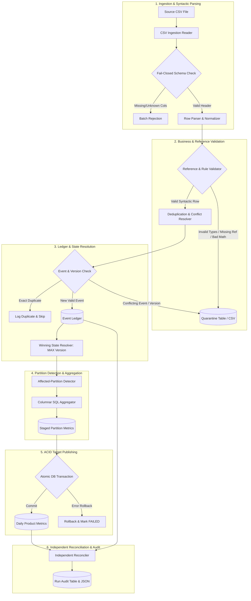
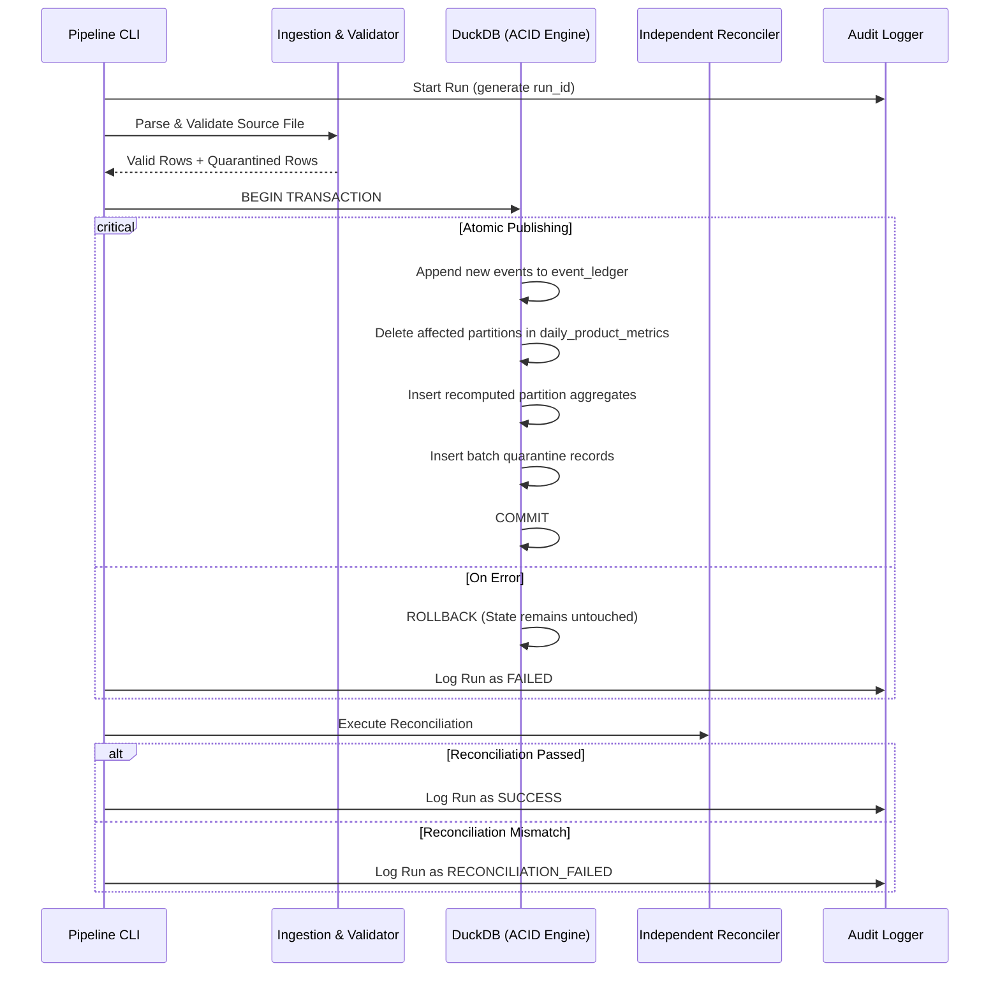

# System Architecture and Processing Flow

This document details the architectural design, component responsibilities, end-to-end data flow, transaction boundaries, error handling, and recovery strategies for the Daily Metrics Pipeline.

---

## 1. High-Level Architecture Diagram

---

## 2. Component Responsibilities

| Module | Python File | Primary Responsibility |
|---|---|---|
| **Config & CLI** | `src/daily_metrics/config.py` `src/daily_metrics/cli.py` | Command-line interface, database path configuration, directory resolution, and parameter parsing. |
| **Data Generator** | `src/daily_metrics/generator.py` | Deterministic synthetic dataset generator producing valid transactions, updates, reversals, duplicates, late events, and corrupt rows. |
| **Ingestion** | `src/daily_metrics/ingestion.py` | Reads source CSV, enforces strict schema matching (fails closed on unexpected or missing columns), tracks source lineage and row numbers. |
| **Validation** | `src/daily_metrics/validation.py` | Validates reference integrity against `reference_products` and `reference_customers`, enforces positive versions, quantities, non-negative prices, and ISO-8601 timestamps. Routes failures to quarantine. |
| **Event Resolution** | `src/daily_metrics/event_resolution.py` | Detects exact duplicates, conflicting duplicate event IDs, and conflicting transaction versions. Resolves winning state via monotonically increasing `event_version`. |
| **Transformations** | `src/daily_metrics/transformations.py` | Determines affected `(metric_date, product_id)` partitions by diffing prior winning states with new winning states. Executes exact decimal aggregations. |
| **Publishing** | `src/daily_metrics/publishing.py` | Executes atomic ACID transaction in DuckDB to insert ledger events, replace affected target partition metrics, persist quarantine records, and handle empty partition cleanup. |
| **Reconciliation** | `src/daily_metrics/reconciliation.py` | Performs independent full-state verification between raw ledger transactions and published target metrics. Generates machine-readable variance reports. |
| **Audit & Logging** | `src/daily_metrics/audit.py` | Generates unique `run_id`, structured JSON logs, and records complete execution metadata in `run_audit`. |

---

## 3. End-to-End Data Flow

1. **Batch Ingestion**:
   - The CLI accepts `--input-file`, `--db-path`, `--reference-dir`, and `--output-dir`.
   - A unique `run_id` (UUIDv4) is generated.
   - The header is checked against the authoritative schema contract. If unknown columns exist or mandatory columns are missing, the entire file fails closed.
2. **Business Rule & Reference Validation**:
   - Reference catalogs (`reference_products`, `reference_customers`) are loaded into lookup caches.
   - Each row is validated:
     - UPSERT: `product_id` must exist in active products; `customer_id` must exist in active customers; `quantity > 0`; `unit_price >= 0.00`.
     - REVERSAL: `transaction_id`, `event_id`, `event_version > 0`, `event_ts` mandatory.
     - Malformed rows are routed immediately to the quarantine collector with specific reason codes.
3. **Deduplication and Conflict Resolution**:
   - Canonical payload hash (SHA-256) is computed.
   - Checks against existing ledger:
     - Exact duplicate (`event_id` + `payload_hash` match): Logged as exact duplicate; skipped without modifying metrics.
     - Conflicting duplicate (`event_id` exists with different hash): Quarantined under `CONFLICTING_EVENT_PAYLOAD`.
     - Version conflict (`(transaction_id, event_version)` exists with different `event_id` or hash): Quarantined under `CONFLICTING_TRANSACTION_VERSION`.
4. **Affected-Partition Detection & Aggregation**:
   - For all new valid events, transactions are evaluated against the current database state:
     - Old partition: `(prior_metric_date, prior_product_id)`.
     - New partition: `(new_metric_date, new_product_id)`.
   - All unique affected partitions are identified.
   - Vectorized DuckDB SQL aggregates active transactions (`event_type = 'UPSERT'`) for only those affected partitions.
5. **Atomic Target Publishing**:
   - A database transaction starts (`BEGIN TRANSACTION`).
   - New valid events are appended to `event_ledger`.
   - Affected partition rows in `daily_product_metrics` are deleted and replaced with newly computed aggregates.
   - Empty partitions (where all transactions were cancelled or moved) are cleaned up.
   - Quarantine records are inserted into `quarantine_records`.
   - The transaction commits (`COMMIT`).
6. **Independent Reconciliation**:
   - Post-commit, the `Reconciler` queries `event_ledger` directly using an independent calculation path.
   - Verifies total active transactions, units sold, gross revenue, row count, and per-partition metrics.
   - Emits reconciliation report (`reconciliation_report.json`).
7. **Run Auditing**:
   - Operational statistics are written to `run_audit` and saved as `run_summary.json`.

---

## 4. Transaction Boundaries & Recovery Strategy

### Recovery Protocol
1. **Crash / Interrupt before Commit**:
   - DuckDB's WAL (Write-Ahead Log) automatically recovers the database to the pre-transaction state.
   - No orphan ledger rows or partial metrics exist.
   - The user or scheduler can safely retry the exact same batch.
2. **Idempotent Reruns**:
   - When a previously committed file is resubmitted, all events match existing `event_id` and `payload_hash`.
   - The pipeline identifies them as exact duplicates, skips ledger insertion, recomputes zero partitions, and emits an audit log indicating `exact_duplicate_count = N`.

---

## 5. Backfill Flow

When historical events arrive (e.g., transactions from 30 days ago):
1. Ingestion accepts and validates the historical events.
2. The version resolver determines if the historical event is higher than any existing state for that transaction.
3. The affected-partition detector flags the historical date `(2026-09-29, PROD_001)` as affected.
4. Only that historical partition in `daily_product_metrics` is recalculated and replaced.
5. Current-day metrics remain unaffected.
6. Reconciliation verifies that both historical and present-day aggregates match the complete ledger.
